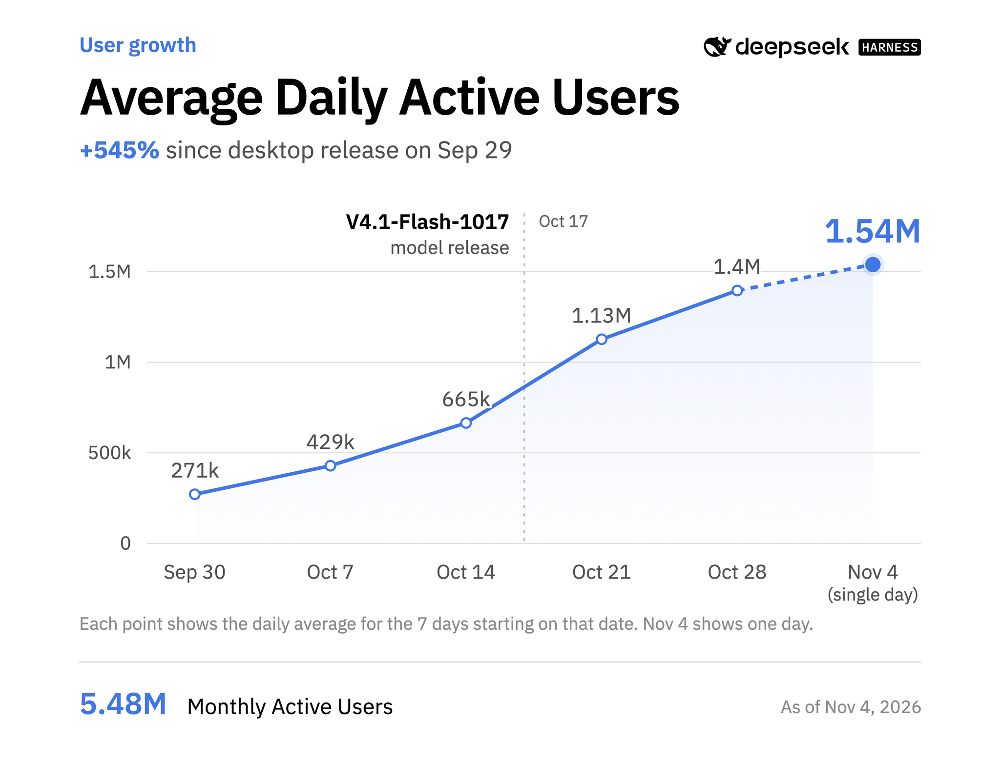
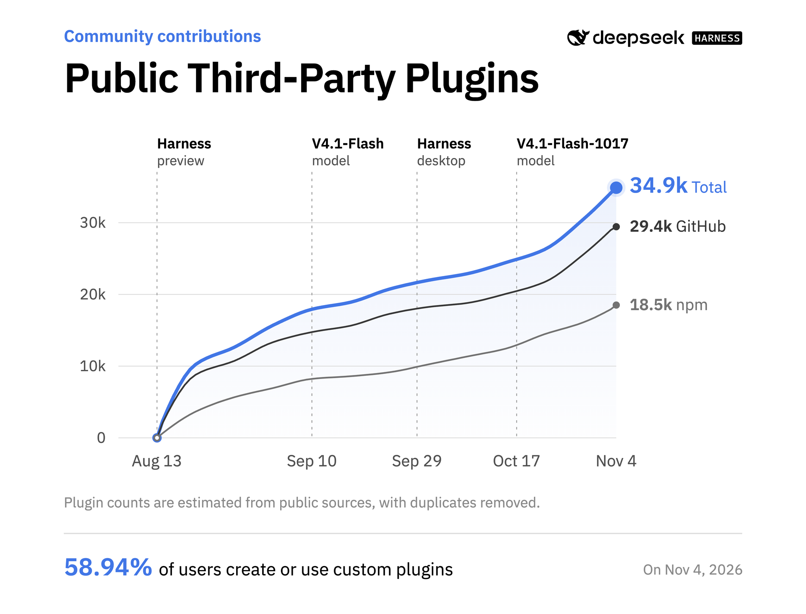

DeepSeek Harness a atteint 1,54 million d’utilisateurs actifs quotidiens au 4 novembre, moins de trois mois après son lancement, a annoncé l’entreprise chinoise d’intelligence artificielle dimanche 8 novembre. Les utilisateurs qui passent par l’API officielle consommaient environ 92 000 milliards de *tokens* par jour au 4 novembre, soit, par conversion, un peu plus d’un milliard par seconde.

Un *harness* est l’infrastructure logicielle qui transforme un grand modèle de langage en agent capable d’exécuter des tâches à la place de l’utilisateur, plutôt que de se contenter de répondre à des invites. OpenAI et Anthropic ont bâti sur leur avance dans ce domaine avec leurs produits de codage, Codex et Claude Code.

DeepSeek Harness est en ligne depuis le 13 août, et une application de bureau a suivi le 29 septembre, permettant aux développeurs de faire tourner des agents qui exécutent du code et se servent de logiciels externes. L’entreprise dit que le nombre de plugins tiers a atteint environ 35 000 depuis le lancement, et qu’environ 60 % des utilisateurs actifs en ont créé ou installé au moins un.

« Notre objectif est que Harness agisse comme un système d’exploitation pour l’ère des agents », a déclaré Cui Tianyi, ancien ingénieur de Jane Street arrivé dans l’équipe en mars, dans un message publié dimanche. Il compare le produit à un système d’exploitation de téléphone, livré avec son réveil et sa calculatrice et ouvert à d’autres fonctions par plugins, comme les utilisateurs de smartphone téléchargent des applications en remplacement de celles d’origine.

Le billet publié en anglais sur X et en chinois sur WeChat présente quatre plugins et leurs auteurs. L’un réunit lecture, surlignage et traduction d’articles scientifiques, avec la possibilité d’interroger un agent sur le texte. Un autre montre aux développeurs quelles informations un agent utilise et comment elles changent au fil de la conversation.

DeepSeek dit qu’il construira un marché où les développeurs publieront leurs plugins et à partir duquel les utilisateurs pourront les télécharger et les installer. Le programme de soutien annoncé offrira aux auteurs des subventions sous forme de *tokens*, des échanges techniques et de la promotion. Dans la conception de DeepSeek Harness, « tout est plugin » : les fonctions intégrées peuvent elles-mêmes être remplacées par des plugins tiers.

L’entreprise tourne de plus en plus son attention vers la monétisation de ses modèles. Le mois dernier, elle a réuni ses équipes Harness, Web, App et Platform dans une division produit, dirigée par Cui, selon le quotidien chinois The Paper, repris par [Sina](https://finance.sina.com.cn/jjxw/2026-10-16/doc-inivmazr8335313.shtml).

*Source des visuels : @DeepSeekHarness, billet du 8 novembre 2026.*
