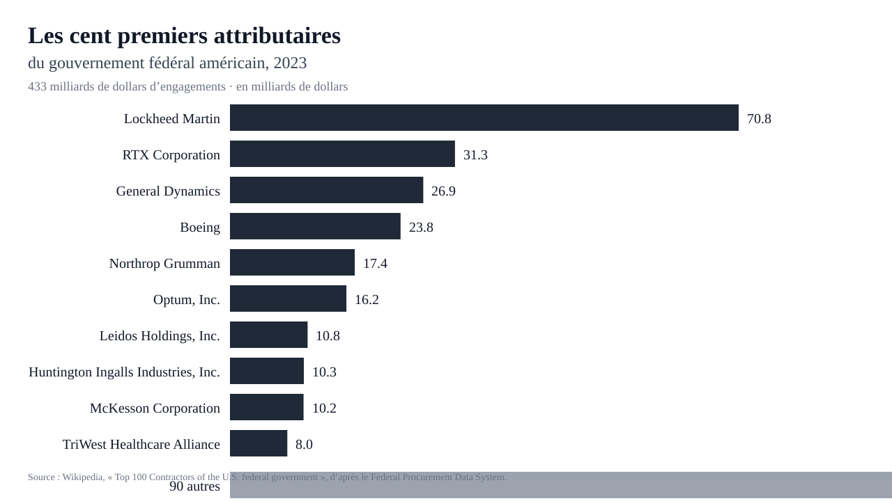
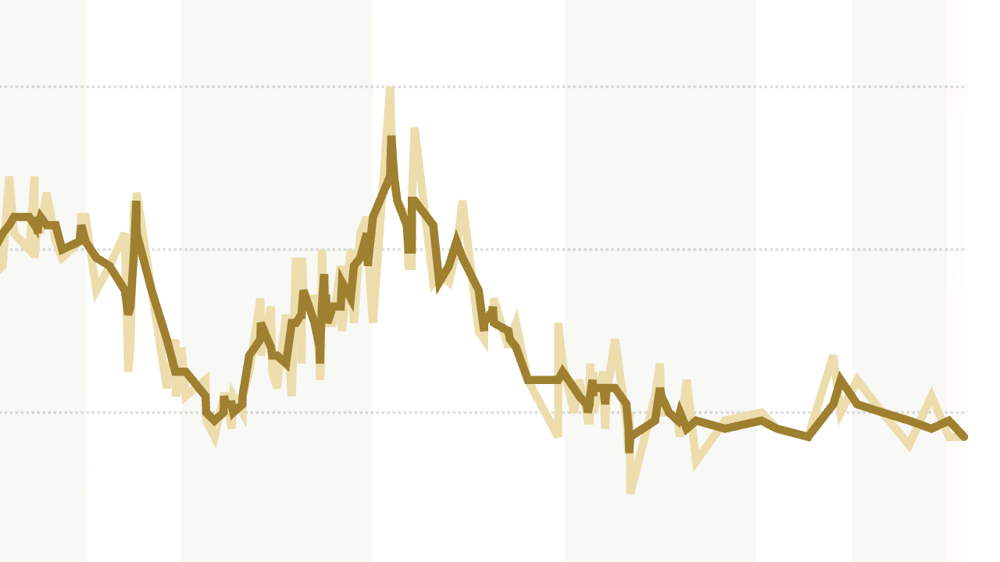

Le 3 novembre 2026, aux États-Unis, les républicains ont [perdu les deux chambres](https://babel.ua/en/news/131519-reuters-the-us-congress-democrats-may-restore-aid-to-ukraine-even-despite-trump-s-veto). Quelques heures après le résultat, le vice-président JD Vance a déclaré : « La raison de notre défaite, c’est la guerre. Le président l’a dit lui-même hier soir. » Il avait déconseillé l’attaque du [28 février](https://news.cgtn.com/news/2026-03-02/Timeline-U-S-Israel-strike-on-Iran-escalates-into-regional-conflict-1LbiVLwZMQM/p.html) et a rendu publique son opposition. Une nouvelle attaque diviserait publiquement le président et son vice-président, et le chef de l’exécutif a commencé à minimiser, parlant d’une guerre qui n’en serait pas vraiment une.

La contrainte matérielle pèse plus lourd que les discours. Les missiles de croisière et les intercepteurs Patriot ont été consommés au point qu’il faudra des années et des milliards de dollars pour reconstituer les stocks. La [base navale de Bahreïn](https://nos.nl/artikel/2631158-vs-bouwde-netwerk-van-militaire-bases-rond-iran-nu-blijken-die-zelf-doelwit) est endommagée au point qu’on doute de la reconstruire. Un pays qui vient de voter sur le coût de la vie, dont l’essence a renchéri à cause de la guerre, ne finance pas volontiers le théâtre suivant. Les alliés le sentent : Anders Fogh Rasmussen, ancien secrétaire général de l’Otan, craint que « tout cela ne produise une Amérique plus isolationniste ». Le repli reste le chemin le moins coûteux pour cette administration, mais il est loin d’être certain que la victoire démocrate promette moins de conflit ou même une Amérique moins interventionniste. La nouvelle majorité veut reprendre l’[aide militaire et financière directe à Kyiv](https://www.reuters.com/world/us/five-ways-us-foreign-policy-may-change-with-democratic-congress-2026-11-04/), suspendue par le président, et espère une majorité suffisante pour surmonter un veto ; elle en parle pour janvier.

## Un vote ne suffit pas

Le [précédent de 2006](https://archive.nytimes.com/www.nytimes.com/cq/2006/11/08/cq_1923.html) mérite aussi qu’on s’y attarde. Après la victoire démocrate de novembre, George W. Bush a annoncé une [escalade en Irak](https://www.abc.net.au/news/2007-01-11/bush-says-iraq-plan-needed-to-thwart-global/2171214) le 10 janvier 2007 ; le Congrès a voté un calendrier de retrait, le président y a opposé son veto le [1er mai](https://georgewbush-whitehouse.archives.gov/news/releases/2007/05/20070501-6.html), et le [financement est passé le 24 mai](https://www.nytimes.com/2007/05/24/washington/24cnd-cong.html) sans condition. Le schéma est familier : le scrutin change la majorité, mais la politique militaire du pays s’exerce dans la continuité. En Corée, l’armistice signé à Panmunjom le [27 juillet 1953](https://www.archives.gov/milestone-documents/armistice-agreement-restoration-south-korean-state) a suspendu les combats sans traité de paix, et les [forces américaines sont restées](https://www.congress.gov/crs-product/IF13246). Dwight Eisenhower avait été élu sur le rejet d’un enlisement coûteux ; il a mis fin aux combats, pas au dispositif. La série est courte et se répète : 1952, 1968, 2006. À chaque fois, un rejet électoral, et la même continuité militaire.

Le camp qui fait campagne contre les guerres permanentes ne reste pas antimilitariste très longtemps. L’opposition démocrate à la guerre d’Irak n’a empêché ni le [renfort en Afghanistan en 2009](https://www.centcom.mil/MEDIA/NEWS-ARTICLES/News-Article-View/Article/883960/president-calls-for-30000-more-us-troops-in-afghanistan/) ni le [retour des troupes en Irak en 2014](https://www.abc.net.au/news/2014-09-11/islamic-state-obama-vows-to-wage-campagin-against-militants/5735990). L’administration qui promettait de régler la guerre d’Ukraine en un jour a ouvert un front iranien, puis approuvé une [vente de missiles Patriot à Kyiv](https://www.abc.net.au/news/2026-10-31/ukraine-war-patriot-missiles-sale-approved-by-us-congress/107331652) à la fin d’octobre. 

Il y a plusieurs raisons à ça. Économiques d’abord — les coûts politiques des guerres impopulaires tombent sur les administrations élues mais les contrats distribués, eux, sont très profitables. Les sommes en jeu exercent leurs propres pesanteurs dans le champ politique, quel que soit le parti. En 2023, le gouvernement fédéral a engagé [433 milliards de dollars](https://en.wikipedia.org/wiki/Top_100_Contractors_of_the_U.S._federal_government) en contrats auprès de ses cent premiers attributaires, dont une large part est allée à une poignée de groupes de défense. Les programmes d’armement, les sous-traitants et les emplois qu’ils distribuent dans les circonscriptions survivent aux scrutins qui les désavouent.

*Source : Wikipedia, « Top 100 Contractors of the U.S. federal government », d’après le Federal Procurement Data System.*

D’autre part, la croyance que la supériorité militaire est suffisante pour assurer des résultats politiques et diplomatiques satisfaisants est tenace. Ça n’a certainement pas été le cas pour le conflit au Vietnam où, pris dans une guerre politiquement toxique, Lyndon Johnson a renoncé à se représenter le [31 mars 1968](https://www.presidency.ucsb.edu/documents/the-presidents-address-the-nation-announcing-steps-limit-the-war-vietnam-and-reporting-his), ni en Afghanistan, où les talibans chassés en 2001 sont revenus au pouvoir en [2021](https://www.congress.gov/crs-product/IN11725). En Iran, les responsables américains décrivent une marine déjà coulée ; Téhéran se révèle résilient cependant et garde la main sur le détroit d’Ormuz. La défaite de l’adversaire sur le champ de bataille ne produit pas en soi sa capitulation politique.

La continuité de l’appareil tient aux intérêts qui le font vivre, à l’inertie institutionnelle et à un cadre idéologique rigide. Elle s’avère remarquablement insensible aux coûts de l’interventionnisme militaire.

## Une facture qui s’alourdit

Ces coûts se traduisent d’abord par une perte de légitimité interne et externe : la confiance dans le gouvernement fédéral est tombée à [17 %](https://www.pewresearch.org/politics/2025/12/04/public-trust-in-government-1958-2025/) en 2025, au terme d’une érosion que les guerres ont accélérée. Un État qui doute de son propre jugement mobilise plus difficilement, et ses adversaires le savent : la lassitude américaine est devenue une variable de leurs plans. La guerre en Iran a ajouté à cette défiance le spectacle d’objectifs changeants et de stocks entamés.

*Source : Pew Research Center, « Public Trust in Government : 1958-2025 », 4 décembre 2025.*

La dette détenue par le public atteint [101 % du PIB](https://www.americanactionforum.org/insight/cbo-projects-troubling-long-term-budget-outlook/) à la fin de 2026, et les intérêts nets qu’elle absorbe représentent [3,3 % du PIB](https://www.americanactionforum.org/insight/cbo-projects-troubling-long-term-budget-outlook/). Cette contrainte budgétaire limite le déploiement de ressources pourtant nécessaires à la puissance : reconstitution des stocks, présence avancée, crédit diplomatique, etc.

L’inertie économique et politique qui contraint la politique extérieure d’un Empire et l’enlise dans des guerres permanentes affaiblit en fin de compte les leviers de la puissance nationale.
